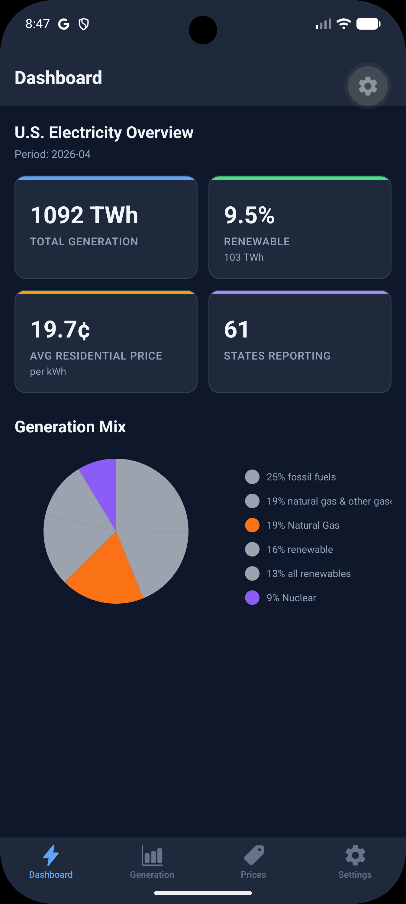

# ⚡ Energy Insights

A React Native + TypeScript mobile app for visualizing U.S. electricity generation and pricing data. Built with [Expo](https://expo.dev/) and powered by the free [EIA API](https://www.eia.gov/opendata/). Designed as a portfolio project demonstrating React Native fundamentals.

<p align="center">
  
</p>

---

## 📱 Screens

| Screen | Description |
|---|---|
| **Dashboard** | At-a-glance summary cards (total generation, % renewable, avg price) + generation mix pie chart |
| **Generation** | Bar chart of net generation by fuel type (natural gas, coal, nuclear, wind, solar, hydro) with renewable badges |
| **Prices** | Searchable FlatList of all 50 states with residential electricity price (¢/kWh); tap to drill into a state |
| **State Detail** | 12-month line chart of residential price trend for a selected state |
| **Settings** | Dark mode toggle + default state selection (persisted via AsyncStorage) |

---

## 🏗 Architecture

```
EIA API (free key, no credit card)
    https://api.eia.gov/v2/electricity/
    ↓  Axios + URLSearchParams
eiaClient.ts  ──  typed fetch helpers + transform functions
    ├─ fetchGenerationRaw()     → raw generation data
    ├─ fetchRetailPricesRaw()   → raw price data by state
    └─ fetchStatePriceTrendRaw()→ 12-month trend for one state
    ↓  TanStack Query hooks (caching, loading/error states)
useGenerationMix / useRetailPrices / useStateDetail
    ↓  React Navigation (Bottom Tabs + nested Stack)
DashboardScreen / GenerationScreen / PricesScreen / StateDetailScreen / SettingsScreen
```

---

## 🛠 Tech Stack

| Layer | Tool |
|---|---|
| Framework | React Native + Expo SDK 57 |
| Language | TypeScript (strict) |
| Navigation | React Navigation v7 (Bottom Tabs + Stack) |
| Data fetching | TanStack Query v5 (caching, stale-while-revalidate) |
| Global state | Zustand v5 |
| Persistence | @react-native-async-storage/async-storage |
| HTTP | Axios |
| Charts | react-native-chart-kit (BarChart, LineChart, PieChart) |
| Unit testing | Jest + @testing-library/react-native |
| E2E / UI testing | Maestro (YAML flow files) |
| CI/CD | GitHub Actions |
| API | EIA v2 (free, registration required) |

---

## 🔑 EIA API Key Setup

1. Register at [https://www.eia.gov/opendata/register.php](https://www.eia.gov/opendata/register.php) — free, instant
2. Copy your API key
3. Create a `.env.local` file in the project root:

```
EXPO_PUBLIC_EIA_API_KEY=your_api_key_here
```

> **Never commit `.env.local`** — it is already in `.gitignore`.

For CI, add the key as a GitHub Actions secret named `EIA_API_KEY`.

---

## 🚀 Getting Started

### Prerequisites

- Node.js 18+
- [Expo Go](https://expo.dev/go) on your phone, **or** a running iOS/Android simulator

### Install & run

```bash
git clone https://github.com/<you>/energy-insights.git
cd energy-insights
npm install
cp .env.example .env.local   # then fill in your EIA API key
npx expo start
```

Scan the QR code with Expo Go on iOS/Android, or press `i` for iOS Simulator / `a` for Android Emulator.

---

## 🧪 Testing

### Unit tests (Jest + RNTL)

```bash
npm test
```

Covers: components (SummaryCard, PriceListItem, LoadingSpinner), custom hooks (useGenerationMix, useRetailPrices), and Zustand store (useAppStore). All API calls are mocked — no real API key needed.

### E2E tests (Maestro)

Requires Maestro installed (`curl -Ls "https://get.maestro.mobile.dev" | bash`) and the app running in a simulator.

```bash
maestro test e2e/dashboard.yaml
maestro test e2e/prices_search.yaml
# ... or run all:
for f in e2e/*.yaml; do maestro test "$f"; done
```

---

## 📂 Project Structure

```
energy-insights/
├── App.tsx                          # Root: QueryClientProvider + NavigationContainer + ThemeProvider
├── src/
│   ├── api/
│   │   ├── eiaClient.ts             # Axios + typed EIA request helpers + transforms
│   │   └── types.ts                 # TypeScript interfaces + FuelTypeId enum
│   ├── components/
│   │   ├── SummaryCard.tsx          # Metric card with accent bar
│   │   ├── GenerationChart.tsx      # BarChart wrapper for fuel generation
│   │   ├── PriceListItem.tsx        # FlatList row (color-coded price)
│   │   └── LoadingSpinner.tsx       # Centered ActivityIndicator
│   ├── hooks/
│   │   ├── useGenerationMix.ts      # TanStack Query: US generation by fuel
│   │   ├── useRetailPrices.ts       # TanStack Query: residential price by state
│   │   └── useStateDetail.ts        # TanStack Query: 12-month trend for one state
│   ├── navigation/
│   │   ├── TabNavigator.tsx         # Bottom tabs + Prices→StateDetail stack
│   │   └── types.ts                 # Typed nav params
│   ├── screens/
│   │   ├── DashboardScreen.tsx
│   │   ├── GenerationScreen.tsx
│   │   ├── PricesScreen.tsx
│   │   ├── StateDetailScreen.tsx
│   │   └── SettingsScreen.tsx
│   ├── store/
│   │   └── useAppStore.ts           # Zustand: isDarkMode, selectedState (persisted)
│   └── theme/
│       ├── colors.ts                # Light/dark color tokens
│       └── ThemeContext.tsx         # ThemeProvider + useTheme hook
├── __tests__/                       # Jest unit tests
│   ├── components/
│   ├── hooks/
│   └── store/
├── e2e/                             # Maestro YAML flows
│   ├── dashboard.yaml
│   ├── generation.yaml
│   ├── prices_search.yaml
│   ├── state_detail.yaml
│   └── settings.yaml
└── .github/workflows/
    ├── unit-tests.yml               # Ubuntu, jest, every push
    └── e2e-tests.yml                # macOS, Maestro + iOS Simulator, main only
```

---

## 🔬 React Native Concepts Demonstrated

| Concept | Where |
|---|---|
| **Navigation** (bottom tabs + nested stack) | `src/navigation/TabNavigator.tsx` |
| **FlatList** with search filter | `src/screens/PricesScreen.tsx` |
| **Custom hooks** | `src/hooks/` |
| **TanStack Query** (caching, loading/error) | all hooks |
| **TypeScript** strict interfaces | `src/api/types.ts` |
| **Zustand** global state | `src/store/useAppStore.ts` |
| **AsyncStorage** persistence | store persist config |
| **Charts** (bar, line, pie) | `src/components/GenerationChart.tsx`, screens |
| **Context** (theme/dark mode) | `src/theme/ThemeContext.tsx` |
| **Unit tests** (Jest + RNTL) | `__tests__/` |
| **E2E tests** (Maestro) | `e2e/` |
| **CI/CD** (GitHub Actions) | `.github/workflows/` |

---

## 📊 Data Sources

All data is sourced from the **U.S. Energy Information Administration (EIA) API v2** — free, no billing required.

| Endpoint | Used for |
|---|---|
| `/v2/electricity/electric-power-operational-data/data/` | Generation mix by fuel type |
| `/v2/electricity/retail-sales/data/` | Residential electricity price by state |

EIA data is updated monthly.

---

## 📄 License

MIT
